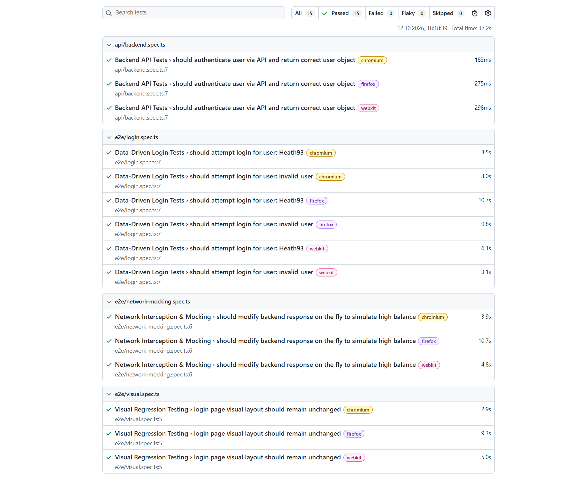
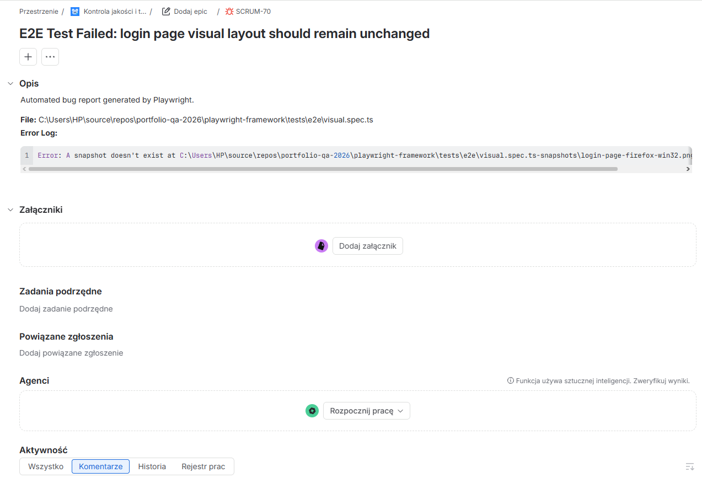

# Advanced Playwright Automation Framework - Fintech App

This is a comprehensive automated End-to-End (E2E) and API testing framework built with Playwright and TypeScript. I created this project to practice and showcase advanced test automation patterns on a complex financial application.

## Table of Contents
1. [Project Overview](#project-overview)
2. [Key Features & Decisions](#key-features--decisions)
3. [Tech Stack](#tech-stack)
4. [Proof of Execution (Screenshots)](#proof-of-execution-screenshots)
5. [Local Development](#local-development)
6. [Scripts](#scripts)
7. [Test Credentials](#test-credentials)
8. [Contact](#contact)

## Project Overview
The goal of this project is to build a reliable automated testing suite covering UI, API, and visual regression tests. It includes a fully functioning CI/CD pipeline integrated with GitHub Actions and automatic bug reporting to Jira. 

*Note: The target application, Cypress RealWorld App, is an open-source project created by Cypress.io for educational purposes. I am using it here strictly as a test target under its open-source license.*

## Key Features & Decisions

I focused on keeping the code clean, maintainable, and fast by using the following patterns:

*   **Page Object Model (POM) & Custom Fixtures:** I separated the test logic from the UI elements. This makes the tests much easier to read and maintain. I also used custom Playwright fixtures to handle the setup and teardown steps cleanly.
*   **Session Storage (Bypassing Login):** To speed up test execution, the framework logs in only once during the Global Setup. It saves the session state (cookies) to a `.json` file and reuses it in all other tests. This skips the redundant login UI flow completely.
*   **Data-Driven Testing:** User credentials and other test data are kept in external JSON files (`src/utils/loginTestData.json`). This makes it easy to run the same test scenario with different data without duplicating code.
*   **Network Mocking:** The framework can intercept API requests. I used this to test edge cases without changing the actual database (for example, dynamically mocking a backend response to show a very high account balance).
*   **API Testing:** I added tests that talk directly to the backend API to verify data independently of the frontend, which speeds up test execution.
*   **Visual Regression Testing:** The project includes visual tests (`expect(page).toHaveScreenshot()`) to catch unexpected CSS or layout changes by comparing them against baseline images generated in the CI environment.
*   **Secrets Management:** Sensitive data, such as Jira API tokens, is secured using local `.env` files and GitHub Secrets in the pipeline, ensuring no credentials are leaked in the repository.

## Tech Stack

*   **Playwright** - Main automation tool (fast, auto-waiting, built-in network interception).
*   **TypeScript** - Adds static typing to catch errors early and improve code autocomplete.
*   **GitHub Actions** - CI/CD pipeline that runs tests automatically. It uses Sharding to split tests across multiple machines and finish faster.
*   **dotenv** - Manages environment variables locally so sensitive URLs are not hardcoded.
*   **Custom Jira Reporter** - A script I wrote to automatically create Jira tickets if a test fails in the pipeline.

## Proof of Execution (Screenshots)

*Here is a quick look at the framework in action:*

### 1. Playwright HTML Report


### 2. Automatic Bug Creation in Jira
When a test fails in the CI pipeline, the framework automatically generates a ticket with the exact error log.


## Local Development

If you want to run this project on your machine, follow these steps:

**Requirements:**
*   Node.js installed (v18+)
*   A local instance of the [Cypress RealWorld App](https://github.com/cypress-io/cypress-realworld-app) must be running.

**Setup:**

1.  Clone this repository:
    ```bash
    git clone https://github.com/pawelskraba01/Playwright-Fintech-Automation-Framework.git
    cd Playwright-Fintech-Automation-Framework
    ```

2.  Install all dependencies:
    ```bash
    npm install
    ```

3.  Create a `.env` file in the main folder and add your local URLs:
    ```env
    BASE_URL=http://localhost:3000
    API_URL=http://localhost:3001
    ```

4.  Run the tests:
    ```bash
    npm run test
    ```

## Scripts

I added some useful shortcuts in `package.json`:

*   `npm run test` - Runs all tests in the background (headless mode).
*   `npm run test:ui` - Opens the Playwright UI mode (great for debugging).
*   `npm run test:api` - Runs only the API tests.
*   `npm run report` - Opens the HTML test report.

## Test Credentials

To interact with the local application instance manually, you can use the default dummy accounts provided by the Cypress RealWorld App (which are also used in my data-driven tests):

*   **Username:** `Heath93`
*   **Password:** `s3cret`

## Contact

*   **LinkedIn:** [Paweł Skraba](www.linkedin.com/in/pawel-skraba)
*   **GitHub:** [pawelskraba01](https://github.com/pawelskraba01)